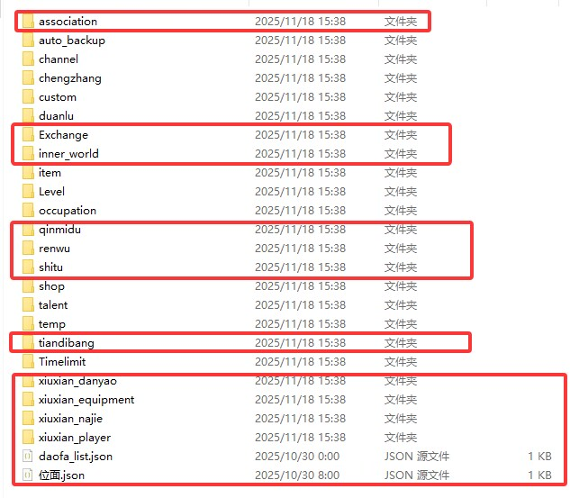
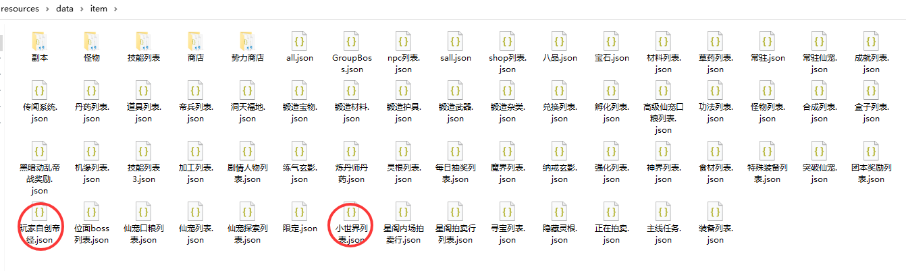

<div align="center">
<br>
<h1>诸天万界修仙V1.0「遮天三部曲」
</img>
</h1>
</br>
</div> 
       
## 仓库来源与致谢

> 本仓库是 **Gitee 原仓库 `mo-wuming/zhutianxiuxian1.0` 的继承（个人维护分支）**，并非原作者的官方仓库。

| 项目 | 信息 |
| --- | --- |
| 原仓库 | <https://gitee.com/mo-wuming/zhutianxiuxian1.0> |
| 原作者 | **莫无铭**（Gitee [@mo-wuming](https://gitee.com/mo-wuming)） |
| 原项目 | 诸天万界修仙 V1.0「遮天三部曲」；基于云崽机器人运行、绝云间修仙框架魔改 |
| 开源协议 | **GPL-2.0**（沿用原仓库许可） |
| 更早的源头 | [绝云间修仙 V1.3.0](https://gitee.com/hutao222/DDZS-XIUXIAN-V1.3.0)，原作者 [@DD斩首](https://gitee.com/hutao222) |
| 本仓库 | <https://github.com/wuhen007/zhutianxiuxian1.0>（wuhen007 个人维护） |

本分支在原版基础上做了部署与功能层面的本地化修改：QQ 官方机器人通道接入与代发、玩法管理权限下放群主、区服名与跨服频道、轮回转世掉落保护期与播报、以及若干玩法与文案调整。**玩法主体、素材与原始设计版权归原作者及社区贡献者所有**，此处仅作个人使用与维护记录，感谢原作者的开源工作。

## 安装      

> Miao-Yunzai/Yunzai-Bot/目录下执行  
```
git clone https://github.com/wuhen007/zhutianxiuxian1.0.git ./plugins/zhutianxiuxian1.0/


```   
## 安装依赖 

> Miao-Yunzai/Yunzai-Bot/目录下执行  
```
pnpm i    
```

### 开发依赖与环境验收

插件声明的依赖也需在插件目录安装；本地测试应包含开发依赖（`art-template` 用于真实模板编译）。
先进入修仙插件目录，再执行：

```bash
pnpm install
pnpm run check:env
pnpm run test:environment
pnpm run test:ui
```

- `check:env` 只读检查运行／开发依赖入口，以及宿主的 `package.json`、插件基类、公共工具和截图模块；缺项返回非零退出码。检查位置以脚本所在目录为准，不依赖当前终端目录。
- `test:ui` 覆盖玩家面板、装备显示、人物立绘、无尽面板、图鉴与帮助，不启动机器人。模板编译通过不等于浏览器实际截图通过。
- 仅有插件目录和 `node_modules` 不是完整云崽宿主；需真实宿主源码、依赖、配置及 Redis，再从宿主根目录启动，验收命令路由、重启结算、存档和图片发送。
- 环境检查不自动安装依赖、不创建占位宿主文件、不读取玩家存档；它不替代插件实际加载或全量回归。

完整回归优先使用 `pnpm run test:regression`：复制当前工作区及真实宿主源码到系统临时目录，隔离配置与数据，再串行运行 Node 的完整测试发现（包括 `test`、`tests`）。玩家／纳戒／装备存档、备份和私有配置不复制；默认世界频道关闭，测试中的本机回环服务照常运行。依赖目录复用本机安装，不下载或升级包；宿主缺依赖时测试仍会失败。

命令结束后保留副本、`regression.tap` 与 `result.json`，打印绝对路径；失败返回非零退出码。副本隔离不是操作系统安全沙箱，也不替代真实群聊、Redis、浏览器截图和生产并发验收。直接执行 `pnpm test` 仍会在当前工作区运行，适合已有独立测试环境时使用。

## 世界聊天：安装后连接，群内加入一次

插件启动后会按接入配置尝试自动登记、连接公共总机，并在断线后自动重连。
由**群主、群管理员或机器人主人**在需要接收消息的群里发送：

```text
#加入世界聊天
#世界状态
```

总机连接成功且本群已加入后，机器人会实时转发其他区服的世界发言；成员用 `#世界发言 内容` 发出跨服消息。
`#世界帮助` / `#世界聊天` 查看完整操作菜单，`#退出世界聊天` 停止本群接收。
菜单也已加入 `#修仙帮助`、`#诸天帮助` 和 `#修仙管理`。

不会自动加入所有群，也不会上传普通群聊。新设备仍需有效的总机登记配置；“本群已加入”只代表订阅已保存，具体连通状态以 `#世界状态` 为准。
详细权限、显式开关及接入排查见 [世界聊天快速开始](docs/world-chat-quickstart.md)。

## 无尽网页公共中转

默认中继模式下，玩家共用核心服务器的网页入口，各区服机器人主动连接世界聊天总机；
网页请求按票据回到原区服处理，机器人不再自动启动本机无尽网页端口。
`#世界网页` 也通过公共网关读取本区服纳戒、世界记录并进行传音与交易；管理员需同时升级总机、网关和各服插件。
服务器管理员的独立网关构建、部署、健康检查和回滚说明见 [公共网页网关](web-gateway/README.md)。

### 更新公告：分章阅读与 HTML 网页

- `#更新公告` 查看本期图文，每页两项；`#更新公告2`、`#更新公告3` 依次翻页。
- `#公告网页`（也支持 `#更新公告网页`、`#更新公告HTML`）打开公告中心，支持版本概览、目录跳转、分章阅读和历史查阅。
- 公告与图片共用后端 `data/announce.json`，不要求已有角色；世界网页的提示栏也提供公告入口。
- 公共网关需要重新构建发布后才会提供新的 `/announce` 页面。仅更新机器人本地代码不会更新已部署网关的公告，部署步骤见上方网关文档。

## 一键安全更新

机器人主人可直接发送：

```text
#修仙更新
```

该指令会先完整备份 `resources/data` 和修仙 Redis 状态，备份失败时中止更新；拉取成功后自动退出当前进程，由 PM2 或 systemd 守护进程重新拉起 Yunzai。为防止硬重置覆盖存档和本地源码，聊天内强制更新已禁用。

也可以在云服务器的 Yunzai 根目录执行：

```bash
bash plugins/zhutianxiuxian1.0/scripts/update.sh
```

脚本会备份数据、配置和本地源码补丁到 `plugins/zhutianxiuxian1.0/_backups/update/`，默认保留最近 14 份，并自动识别常见 PM2 进程名。自定义 PM2 进程名时使用：

```bash
YUNZAI_PM2_NAME=你的进程名 bash plugins/zhutianxiuxian1.0/scripts/update.sh
```

> [插件已适配频道和TRSS,推荐使用TRSS时雨崽搭配gocq插件以及频道插件使用](https://gitee.com/TimeRainStarSky/Yunzai)
## 转移存档            

   
存档位置  
```
\(Miao-Yunzai/Yunzai-Bot)\plugins\zhutianxiuxian1.0\resources\data
\(Miao-Yunzai/Yunzai-Bot)\plugins\zhutianxiuxian1.0\resources\data\item
```      
若要转移存档，将上面画框的文件保存，将修仙插件删除，执行上面安装命令，将上面画框的文件替换到对应文件,然后执行【#一键同步】 

## 以下为基于原版修仙的魔改内容  
### 诸天序章与三大降临地（2026年10月7日）

- `#踏入仙途` 先展示世界观序章、灾厄与不祥的背景，再选择 `#降临 修仙界`、`#降临 地球` 或 `#降临 试炼宇宙`。选定后才建档；重复选择保留已有角色。
- 修仙界保留灵根、开局异象与原修仙成长；地球接入下述复活地球独立路线。既有角色与原转世流程保持原逻辑。
- 试炼宇宙：全球众生被传送至主神空间，进入末日、灵异、科幻、不可名状、魔幻、修仙六类原创世界，完成指定任务、活着回归后获取积分。发送 `#试炼宇宙 帮助` 查看行动、兑换物品与强化规则。
- 试炼死亡需确认重生，失去本世积分、物品、强化和凭证，保留历史记录；成神需集齐六类世界凭证并达到积分与强化条件，独立神阶对应修仙「无境」，不直接覆盖原修仙等级。

### 复活地球独立凡间路线（2026年9月30日）

- 新凡人角色发送 `#复活地球 入界` 阅读代价，另行确认后从塔监狱开始。采用凡人、炼气、筑基、金丹、元婴、化神独立进度，在化神初期衔接既有仙界；现有高阶角色不会被自动清档迁入。
- 真正死亡清本世修为与随身物资；账户、设施、仓储与已知记录保留，接应只改变复活地点。
- 第七版已有四组狱友事件、四类可疑接应信号。`#复活地球 事件`查看线索，按公开代价调查、核验和选择；`#复活地球 异常档案`回看亲自完成的核验，不增加永久战力或免死保障。
- `#复活地球 筹备`汇总当前突破的材料与固定费用；连续工作、站务危机、履历与死亡复盘继续保留。
- 新增人物、信号、制度与游戏数值属于插件改编；化魔、常规非污染结婴和蝶梦仍待原著正文核实。帮助入口：`#复活地球 帮助`。

开发者可在插件目录做纯内存成长对照，例如：

```bash
node scripts/revival-earth-sim.mjs --seeds 3 --route both --work-batch 10 --expedition-mode tech --expedition-depth 2 --signal-policy tech --crisis-policy technical
```

不传新参数仍是单轮工作、单点隐蔽、不参与危机。批量按当前缺口封顶，不预支工资；更深探索可能耗尽撤离窗口。JSON区分工作次数／劳动轮数、危机支出、探测器各用途、货物交付／损失和预算截断，统计不等同于玩家通关率；详情见成长仿真报告。

### 最近更新：新增玩法与体验优化（2026年8月19日）

#### 新增玩法

- **跨服交易**：不同区服现在可以互相开放交易。玩家能发布灵石、源石或物品订单，交易中的物品会先暂存，成功后再交付，失败会自动退回。
- **仙古秘境新路线**：秘境地图会自动修好旧存档里的断路和死循环，从外围一路探索到核心。高境界雷劫更有压迫感，但不会出现必死的血量门槛。
- **三条修炼路线继续成长**：仙古路、遮天路、花粉路的高阶能力进一步接通。至尊可以走红尘九世，花粉路也能参与帝兵、搜魂、镇魂和轮回玩法；新增 `#回炉重造`，可退一阶重新规划极境。
- **圣墟副本重新开放**：进入前就能看到位面、门槛、消耗和预计收益，探索成功后可以获得呼吸法残页、花粉神术、场域残图等奖励。
- **无尽网页增加队伍工具**：新增队伍聊天、战斗回放、逐回合时间线、构筑、星图和战利品页面，组队过程和战斗结果更容易查看。
- **鱼王与宗门神兽奖励重做**：鱼王奖励分组抽取，宝箱有多次抽取和愿鳞保底；宗门神兽不再掉落明显超出当前阶段的奖励。

#### 优化的问题

- **秘境奖励不再重复发放**：普通副本、沉迷副本、手动领取和定时领取统一处理，同一场战斗只会结算一次。
- **加速副本的发奖时间更准确**：使用结算卡后，后续奖励会按新的时间重新排队，不会提前、漏发或重复扣卡。
- **装备数值显示统一**：角色面板、纳戒、商店和计算器现在使用同一套百分比计算规则，固定属性和百分比属性不再互相打架。
- **轮回与拉新奖励更清楚**：轮回提示会告诉你当前路线和下一步选择，基础拉新奖励增加轮回命签，首档奖励调整为洗根水和定灵仙符。
- **帮助页面更容易看懂**：常用指令补齐跨服交易、回炉、搜魂、轮回和遗珍玩法，图片帮助的文字和卡片也已放大。

### 近期重大更新（2026年7月）

- **仙古秘境全面扩展**：重构碎片地图与探索流程，新增坐标移动、目标推演、地图快照、普通撤离和紧急撤离；加入阵营、NPC交互、商店、组队、擂台、悬赏、凶名排行及本局战利品结算。
- **仙古修炼路线完善**：补充顶级道种与神火极境、祭炼真我、以身为种、斩我至至尊境渡劫、仙气道数与压制效果，并新增仙遗宝地及秘境地图页面。
- **位面坐标与跨界旅行**：建立正式位面坐标、个人坐标记忆和传送阵刻画体系；完善肉身横渡、传送阵、仙王接引、旅行耗时、鲲鹏宝术减时、途中事故与天地无拘任务。
- **位面大事件与世界演化**：新增周期性位面事件、精确地点参与、灵界裂缝、位面商人、红尘仙缘签、位面毁灭与永寂名单，并完善诸天投影、道化之身和万身归真。
- **先天至宝出世与择主**：加入守护灵挑战、先天禁制、灵脉护持、命运乱流、立下道心和公开择主；至宝本体保持唯一归属，榜单次席可获得限时投影。
- **先天至宝权柄**：接入炼妖壶、山河图、混沌钟、崆峒印、六道轮回盘等至宝的独立能力、冷却和跨玩法加成，并支持将至宝置入帝兵位。
- **寿元、轮回与遗落纳戒**：新增简单、普通、困难三档往生规则，以及轮回路执掌、救援与裁定；完善遗落纳戒坐标、附近搜索、物品合并、重复领取保护和失败回滚。
- **命格与开局异象**：新增命格抽取、命格图鉴、正负面词条和开局天地异象；效果已接入突破、炼丹、制符、采集、寻宝、出售、元神、内景地和秘境等主要玩法。
- **悟道与证道成长**：建立王者道则至无缺帝道的己道路线，加入每日悟道、寿元消耗、悟道古茶和旧玩家进度补齐；完善天心合道、护道证帝、特殊体质凌驾万道及渡劫命格效果。
- **精神宇宙与元神神游**：新增稳定度、悟痕、多层探索、三类抉择、主动或强制归位及战利品保留规则，并与元神功法和命格加成联动。
- **小世界经营升级**：离线资源最多积累96个现实小时，修正作物真实成熟度；新增神药丹房、灵田、器阁、符台、矿脉等工坊与专属产出。
- **仙宠生态与诸界互动**：支持仙宠安置、召回、完整属性恢复、工坊分配、精力与休息管理；新增偷菜、保护期、仙宠守卫、野外仙兽遭遇和驯服。
- **源石坊与源术对决**：新增外园、地字号、天字号三座石园，以及勘石、辨伪、购石、一刀切、层层剥石、封源、回购、镇园石王和多人助切；加入NPC对决、石相组合与多档押注结算。
- **问仙令与专项探索**：新增问仙线索、四项试炼、激活升级、暂存道痕和奖励页面；加入天魔化生、万相魔冢、天魔炼化、囚牢之主世界首领、仙界天骄及相关支线任务。
- **战斗与数值修正**：统一单人和组队战斗结果，修正装备百分比属性、突破潜力消耗、高境界丹药限制、每日任务和宗门沉迷秘境的边界逻辑。
- **管理、数据安全与兼容**：新增诸天初始化、公告群同步、难度选择和完整删档；关键轮回及存档操作加入原子写入与事务回滚，同时补充旧存档迁移和重复结算保护。
- **数据、界面与测试**：扩充境界、物品、功法、技能、副本、帮助菜单和展示页面；为主要新玩法补充规则测试，覆盖旧数据兼容、边界条件和幂等结算。

近期重大更新 (2025年10月)

系统完善：彻底完善元神、内景地、灵根进阶系统；新增仙古今世法、生命本源、道伤逻辑。

内容扩展：新增九天十地、下界八域位面及大量副本；更新仙古秘境（大型多人副本）废案。

玩法优化：优化道法赐福、位面传送阵；完善绝灵时代惩罚（物品消散、寿元压制）。

功能新增：新增成就、天骄、剧情人物系统；新增寻宝地图与泰拉瑞亚道具。

界面与自定义：新增多项图鉴系统；允许玩家上传并预览自定义练气皮肤,也能自选存档皮肤。

重要功能更新 (2025年7月 - 2025年9月)

战斗与成长：重写战斗系统，加入分身、控制等效果；增加圣体、命运神道体等成长路线。

世界与位面：增加位面系统、仙域与成仙路；完善破王成帝、仙帝权能及代价。

新玩法：增加小世界、证道成帝、自创功法帝经、传授功法、势力商店、垂钓众生等。

便捷优化：增加一键服用神药、突破、破体功能；优化副本沉迷逻辑，并且可以查看副本掉落物。

遮天元素深度融合：增加遮天位面副本、人体秘境体系、黑暗动乱事件及大量相关灵根功法。 
## 常见问题
>如出现msgTask报错mark错误则是因为一些未知原因无法发送zhutianxiuxian1.0\resources\data\temp\temp.json的消息卡死，将该文件清空打入一个[]即可
## 交流/直接游玩
- 诸天体验服（暂时停止维护）：[QQ群链接跳转](https://qm.qq.com/q/741UDjDZ72)
- 诸天三周目（作者官群）：[QQ群链接跳转](https://qm.qq.com/q/ifm5N9SZ8Y)
- 萌信修仙界（联动官群）：[QQ群链接跳转]https://qm.qq.com/q/K9ACiqIWm6
- 倒霉の妙妙屋4号屋（合作者衍生官群）：[QQ群链接跳转](https://qm.qq.com/q/nCqYx36uvC)

## 配置与存档
> zhutianxiuxian1.0/ config / xiuxian / xiuxian.yaml       
> zhutianxiuxian1.0/ resources / data          
>可根据需求自行修改     
## 免责声明       
1. 功能仅限内部交流与小范围使用       
2. 请勿用于任何以盈利为目的的场景      
## 原作者信息
原插件：[绝云间修仙V1.3.0](https://gitee.com/hutao222/DDZS-XIUXIAN-V1.3.0)  
原作者：[@DD斩首](https://gitee.com/hutao222)
