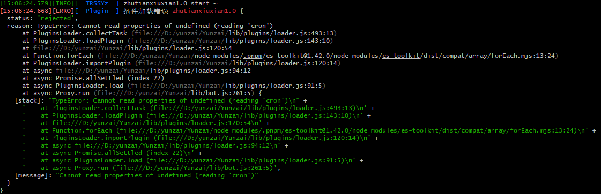

<div align="center">
<br>
<h1>诸天万界修仙V1.0「遮天三部曲」
</img>
</h1>
</br>
</div> 
       
## 安装      

> Miao-Yunzai/Yunzai-Bot/目录下执行  
```
git clone https://gitee.com/mo-wuming/zhutianxiuxian1.0.git ./plugins/zhutianxiuxian1.0/


```   
## 安装依赖 

> Miao-Yunzai/Yunzai-Bot/目录下执行  
```
pnpm i    
```

## 一键安全更新

机器人主人可直接发送：

```text
#修仙更新
```

该指令会先完整备份 `resources/data` 和修仙 Redis 状态，备份失败时中止更新；拉取成功后自动退出当前进程，由 PM2 或 systemd 守护进程重新拉起 Yunzai。为防止硬重置覆盖存档和本地源码，聊天内强制更新已禁用。

也可以在云服务器的 Yunzai 根目录执行：

```bash
bash plugins/zhutianxiuxian1.0/scripts/update.sh
```

脚本会备份数据、配置和本地源码补丁到 `plugins/zhutianxiuxian1.0/_backups/update/`，默认保留最近 14 份，并自动识别常见 PM2 进程名。自定义 PM2 进程名时使用：

```bash
YUNZAI_PM2_NAME=你的进程名 bash plugins/zhutianxiuxian1.0/scripts/update.sh
```

## 小问题
如在运行该修仙插件时遇到以下报错不必惊慌，是我写的时候一个失误，不过此类报错不影响插件正常运行，如果有强迫症可以到云崽根目录的lib/plugins/loader.js中改动定时任务（大概在490行的样子）

```
  /** 收集定时任务 */
  collectTask(task, name) {
    if (!task) return // 如果 task 是 undefined 或 null，直接返回
    for (const i of Array.isArray(task) ? task : [task])
      if (i && i.cron && i.fnc) { // 添加对 i 的检查
        i.name ??= name
        this.task.push(i)
      }
  }
```
> [插件已适配频道和TRSS,推荐使用TRSS时雨崽搭配gocq插件以及频道插件使用](https://gitee.com/TimeRainStarSky/Yunzai)
## 转移存档            

   
存档位置  
```
\(Miao-Yunzai/Yunzai-Bot)\plugins\zhutianxiuxian1.0\resources\data
\(Miao-Yunzai/Yunzai-Bot)\plugins\zhutianxiuxian1.0\resources\data\item
```      
若要转移存档，将上面画框的文件保存，将修仙插件删除，执行上面安装命令，将上面画框的文件替换到对应文件,然后执行【#一键同步】 

## PS:该版本不稳定存在一定bug(绝对路径等)，如需更新请一定要备份好整个原版本，目测可移植原版的修仙插件，但是不保证
## 更新完后一定要发【#一键同步】，不要偷懒直接保存data文件夹
## 以下为基于原版修仙的魔改内容  
### 近期重大更新（2026年7月）

- **仙古秘境全面扩展**：重构碎片地图与探索流程，新增坐标移动、目标推演、地图快照、普通撤离和紧急撤离；加入阵营、NPC交互、商店、组队、擂台、悬赏、凶名排行及本局战利品结算。
- **仙古修炼路线完善**：补充顶级道种与神火极境、祭炼真我、以身为种、斩我至至尊境渡劫、仙气道数与压制效果，并新增仙遗宝地及秘境地图页面。
- **位面坐标与跨界旅行**：建立正式位面坐标、个人坐标记忆和传送阵刻画体系；完善肉身横渡、传送阵、仙王接引、旅行耗时、鲲鹏宝术减时、途中事故与天地无拘任务。
- **位面大事件与世界演化**：新增周期性位面事件、精确地点参与、灵界裂缝、位面商人、红尘仙缘签、位面毁灭与永寂名单，并完善诸天投影、道化之身和万身归真。
- **先天至宝出世与择主**：加入守护灵挑战、先天禁制、灵脉护持、命运乱流、立下道心和公开择主；至宝本体保持唯一归属，榜单次席可获得限时投影。
- **先天至宝权柄**：接入炼妖壶、山河图、混沌钟、崆峒印、六道轮回盘等至宝的独立能力、冷却和跨玩法加成，并支持将至宝置入帝兵位。
- **寿元、轮回与遗落纳戒**：新增简单、普通、困难三档往生规则，以及轮回路执掌、救援与裁定；完善遗落纳戒坐标、附近搜索、物品合并、重复领取保护和失败回滚。
- **命格与开局异象**：新增命格抽取、命格图鉴、正负面词条和开局天地异象；效果已接入突破、炼丹、制符、采集、寻宝、出售、元神、内景地和秘境等主要玩法。
- **悟道与证道成长**：建立王者道则至无缺帝道的己道路线，加入每日悟道、寿元消耗、悟道古茶和旧玩家进度补齐；完善天心合道、护道证帝、特殊体质凌驾万道及渡劫命格效果。
- **精神宇宙与元神神游**：新增稳定度、悟痕、多层探索、三类抉择、主动或强制归位及战利品保留规则，并与元神功法和命格加成联动。
- **小世界经营升级**：离线资源最多积累96个现实小时，修正作物真实成熟度；新增神药丹房、灵田、器阁、符台、矿脉等工坊与专属产出。
- **仙宠生态与诸界互动**：支持仙宠安置、召回、完整属性恢复、工坊分配、精力与休息管理；新增偷菜、保护期、仙宠守卫、野外仙兽遭遇和驯服。
- **源石坊与源术对决**：新增外园、地字号、天字号三座石园，以及勘石、辨伪、购石、一刀切、层层剥石、封源、回购、镇园石王和多人助切；加入NPC对决、石相组合与多档押注结算。
- **问仙令与专项探索**：新增问仙线索、四项试炼、激活升级、暂存道痕和奖励页面；加入天魔化生、万相魔冢、天魔炼化、囚牢之主世界首领、仙界天骄及相关支线任务。
- **战斗与数值修正**：统一单人和组队战斗结果，修正装备百分比属性、突破潜力消耗、高境界丹药限制、每日任务和宗门沉迷秘境的边界逻辑。
- **管理、数据安全与兼容**：新增诸天初始化、公告群同步、难度选择和完整删档；关键轮回及存档操作加入原子写入与事务回滚，同时补充旧存档迁移和重复结算保护。
- **数据、界面与测试**：扩充境界、物品、功法、技能、副本、帮助菜单和展示页面；为主要新玩法补充规则测试，覆盖旧数据兼容、边界条件和幂等结算。

近期重大更新 (2025年10月)

系统完善：彻底完善元神、内景地、灵根进阶系统；新增仙古今世法、生命本源、道伤逻辑。

内容扩展：新增九天十地、下界八域位面及大量副本；更新仙古秘境（大型多人副本）废案。

玩法优化：优化道法赐福、位面传送阵；完善绝灵时代惩罚（物品消散、寿元压制）。

功能新增：新增成就、天骄、剧情人物系统；新增寻宝地图与泰拉瑞亚道具。

界面与自定义：新增多项图鉴系统；允许玩家上传并预览自定义练气皮肤,也能自选存档皮肤。

重要功能更新 (2025年7月 - 2025年9月)

战斗与成长：重写战斗系统，加入分身、控制等效果；增加圣体、命运神道体等成长路线。

世界与位面：增加位面系统、仙域与成仙路；完善破王成帝、仙帝权能及代价。

新玩法：增加小世界、证道成帝、自创功法帝经、传授功法、势力商店、垂钓众生等。

便捷优化：增加一键服用神药、突破、破体功能；优化副本沉迷逻辑，并且可以查看副本掉落物。

遮天元素深度融合：增加遮天位面副本、人体秘境体系、黑暗动乱事件及大量相关灵根功法。 
## 常见问题
>如出现msgTask报错mark错误则是因为一些未知原因无法发送zhutianxiuxian1.0\resources\data\temp\temp.json的消息卡死，将该文件清空打入一个[]即可
## 交流/直接游玩
- 官群1：[QQ群链接跳转](https://qm.qq.com/q/741UDjDZ72)
- 官群2：[QQ群链接跳转](https://qm.qq.com/q/ifm5N9SZ8Y)
- 衍生官群：[QQ群链接跳转](https://qm.qq.com/q/nCqYx36uvC)

## 配置与存档
> zhutianxiuxian1.0/ config / xiuxian / xiuxian.yaml       
> zhutianxiuxian1.0/ resources / data          
>可根据需求自行修改     
## 免责声明       
1. 功能仅限内部交流与小范围使用       
2. 请勿用于任何以盈利为目的的场景      
## 原作者信息
原插件：[绝云间修仙V1.3.0](https://gitee.com/hutao222/DDZS-XIUXIAN-V1.3.0)  
原作者：[@DD斩首](https://gitee.com/hutao222)
